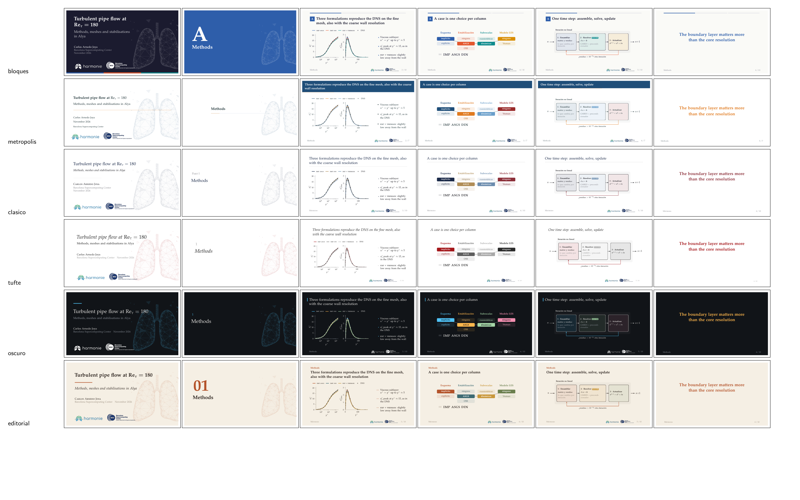
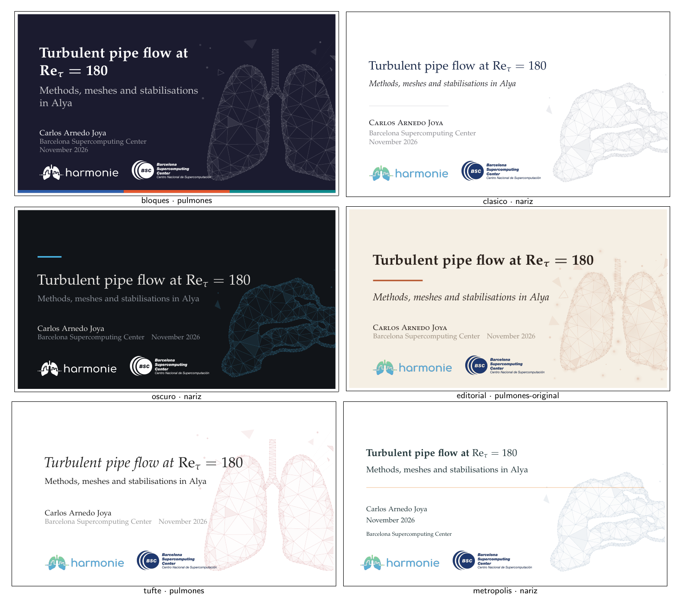
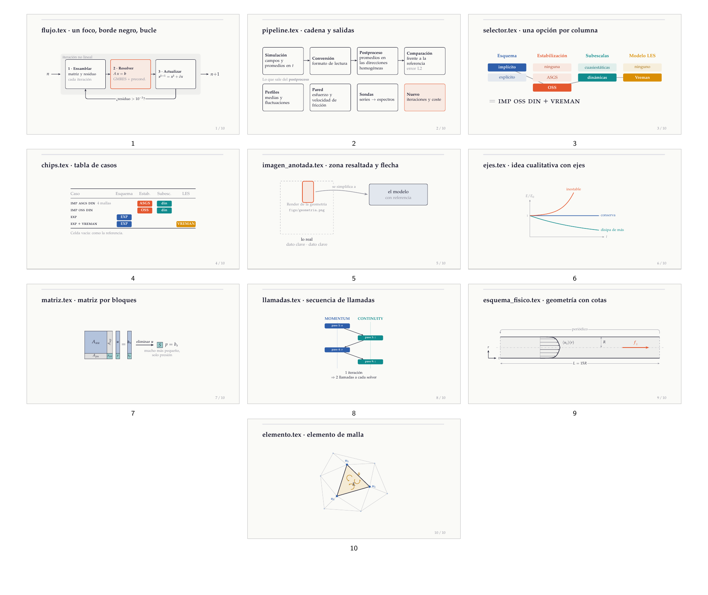

# charlas-charlie

Estilo y caja de herramientas para presentaciones científicas en **Beamer/LaTeX**, empaquetado como
*skill* de [Claude Code](https://claude.com/claude-code): seis temas con un selector, portada con logos,
fondos *low-poly* (pulmones, nariz) que se tiñen con el tema, figuras matplotlib con la misma letra y los
mismos colores que las slides, plantillas de diagramas TikZ y scripts para compilar y **mirar** cada slide.



## Qué hay

```
SKILL.md              instrucciones para Claude (cuándo y cómo usar la skill)
assets/estilo/        el estilo: preambulo.tex, tema-*.tex, charla*.mplstyle, logos/, fondos low-poly
assets/plantilla/     main.tex, make_figs.py y BRIEF.md de una charla nueva
assets/diagramas/     plantillas TikZ (y charla01/: los originales de una charla completa)
references/           temas, diagramas, figuras, diseño, narrativa y trampas (los lee Claude bajo demanda)
scripts/              nueva_charla.sh, compilar.sh, renderizar.sh, hoja_contactos.sh, comparar_temas.sh,
                      lowpoly.py, preparar_logos.py
docs/                 charla de muestra, galería de diagramas e imágenes de este README
tests/                batería de pruebas: qué se pidió, qué salió y qué se corrigió
```

## Instalación

Requisitos: TeX Live con `pdflatex`, `latexmk` y Beamer (con el tema `metropolis` si se usa ese tema);
`poppler` (`pdftoppm`, `pdfinfo`); Python 3 con `matplotlib`, `numpy`, `scipy` y `Pillow` para figuras y
fondos.

```sh
git clone <este repo> ~/skills/charlas-charlie
ln -s ~/skills/charlas-charlie ~/.claude/skills/charlas-charlie     # para Claude Code
```

## Arranque rápido

```sh
~/skills/charlas-charlie/scripts/nueva_charla.sh mi-charla --tema bloques --idioma spanish --titulo "El mensaje"
cd mi-charla
python make_figs.py                                  # figuras de ejemplo con el estilo del tema
~/skills/charlas-charlie/scripts/compilar.sh main.tex
~/skills/charlas-charlie/scripts/hoja_contactos.sh main.pdf
```

Cada charla lleva su propia copia del estilo en `estilo/` (con la versión en `estilo/VERSION`): si el
estilo cambia, las charlas viejas siguen compilando igual.

Con Claude Code basta con pedir la charla («prepárame una charla de 20 minutos sobre…»): la skill se carga
sola por su descripción.

## Parámetros

En `main.tex`, antes de `\input{preambulo}`:

| Macro | Valores (el primero es el de por defecto) |
|---|---|
| `\def\tema{…}` | `bloques` · `metropolis` · `clasico` · `tufte` · `oscuro` · `editorial` |
| `\def\idioma{…}` | `english` · `spanish` |
| `\def\logos{…}` | `harmonie,bsc` · `harmonie-favicon` · `upc` · vacío |
| `\def\logoportada{…}` / `\def\logopie{…}` | `auto` · `color` · `azul` · `negro` · `blanco` · `tenue` |
| `\def\tamlogos{…}` | `normal` · `pequeno` · `grande` |
| `\def\letra{…}` | `palatino` · `charter` · `sans` · `lmodern` |
| `\def\fondoportada{…}` | vacío · `pulmones` · `pulmones-azul`/`-rojo`/`-turquesa`/`-violeta`/`-aire` (colores fijos, fondos claros) · `nariz` · `nariz-llena` · `nariz-silueta` · `vias` · `acino` · `pulmones-original` · `malla` · `remolinos` · una imagen propia |
| `\def\fondoseccion{…}` | fondo de los separadores (por defecto, el de la portada) |
| `\def\progreso{…}` | `numeros` · `barra` · `ambos` |
| `\def\sangrado{…}` | `poco` · `mucho` · cualquier medida |
| `\def\nbloques{N}` | (Bloques) nº de secciones con letra y color |
| `\def\connotas{}` | notas del orador en una segunda pantalla |

Macros: `\frase{}` (slide-frase), `\mensaje{}`, `\caso{}` (versalitas), `\figura{fichero}{ancho}{alto}{qué falta}`
(la figura, o un hueco rotulado si aún no existe), `\ocultarlogos`.

## Fondos



`pulmones` y `nariz` son ilustraciones *low-poly* de un solo color (`motivo`, que define el tema): se
tiñen solas y funcionan sobre fondo claro y oscuro. `scripts/lowpoly.py` las genera desde una silueta o
desde un render con fondo blanco (la nariz sale del render de una cavidad nasal; sus sombras más oscuras
se vacían para que se lean los cornetes).

## Diagramas



Plantillas en `assets/diagramas/`; se copian a la charla y se adaptan. Solo usan tokens de color del tema
(`tinta`, `tenue`, `fondo`, `acento`, `serieA`…`serieD`), así que cambian con él.

## Figuras

`make_figs.py` usa `estilo/charla.mplstyle` (Palatino vía LaTeX, fondo transparente, ejes finos) más
`estilo/charla-<tema>.mplstyle` (colores). Lee el tema de `main.tex` y exporta cada figura al ancho útil
de la slide para incluirla sin escalar.

## Verificación

- `compilar.sh`: compila y resume errores, cajas que se salen (> 1 pt), ficheros que faltan y referencias rotas.
- `renderizar.sh main.pdf 110 [desde hasta]`: una PNG por slide.
- `hoja_contactos.sh main.pdf [columnas] [dpi]`: todas las slides en una imagen numerada.
- `comparar_temas.sh main.tex [páginas] [temas…]`: la misma charla en varios temas, una fila por tema.

La regla de la skill: **nada está hecho hasta que se ha mirado la slide renderizada**.

## Problemas conocidos

- `\begin{frame}{Título}{…}`: el grupo tras el título es el subtítulo. Empieza el contenido con `\noindent`.
- `#` dentro de un frame (estilos TikZ con `#1`) no compila: el diagrama va en un fichero con `\input`.
- Los motivos PDF (`malla`, `remolinos`, `espectro`, `curvas`) son blancos: solo para portadas oscuras.
  `espectro` y `curvas` se regeneran con datos de un proyecto concreto (AIRE).
- `pulmones-original` usa halos con *fadings*: pesa más y se ve peor sobre fondo oscuro que `pulmones`.
- Tema `metropolis`: necesita el paquete `beamertheme-metropolis`.
- Sin `xelatex`/`lualatex`: el estilo es para `pdflatex` (Palatino vía `mathpazo`).
- Más en [`references/trampas.md`](references/trampas.md).

## Pruebas

La skill se probó con subagentes que partían de cero (solo con la skill) en carpetas temporales: ver
[`tests/PRUEBAS.md`](tests/PRUEBAS.md).

## Licencia

MIT (ver `LICENSE`). Los logos de HARMONIE, BSC y UPC son de sus titulares y no entran en la licencia.
